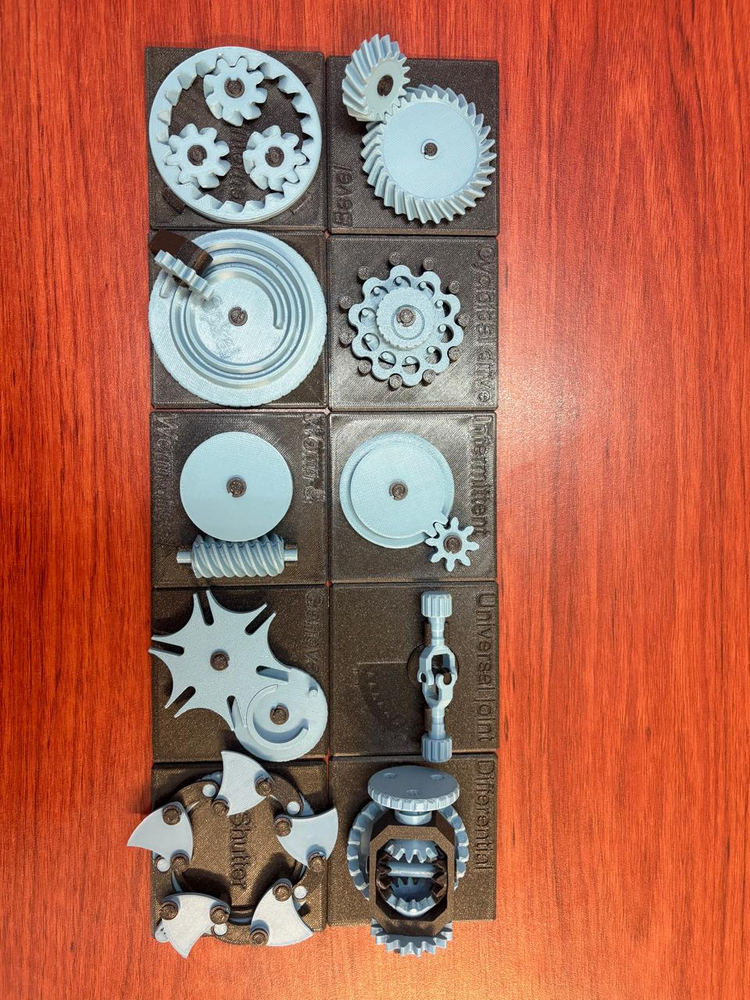
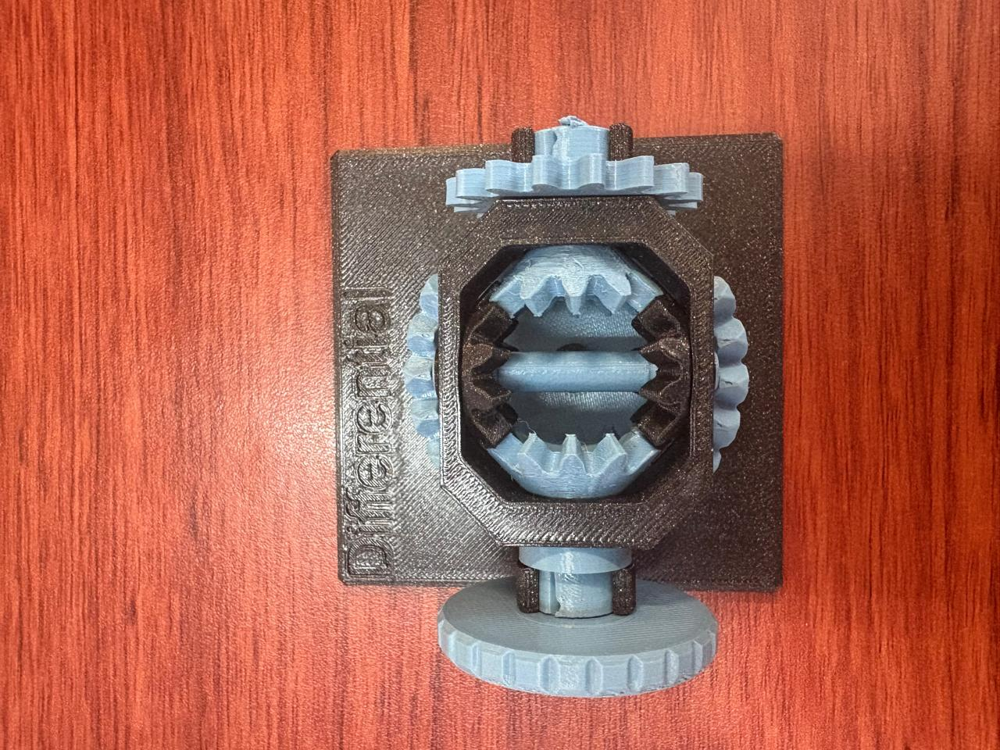
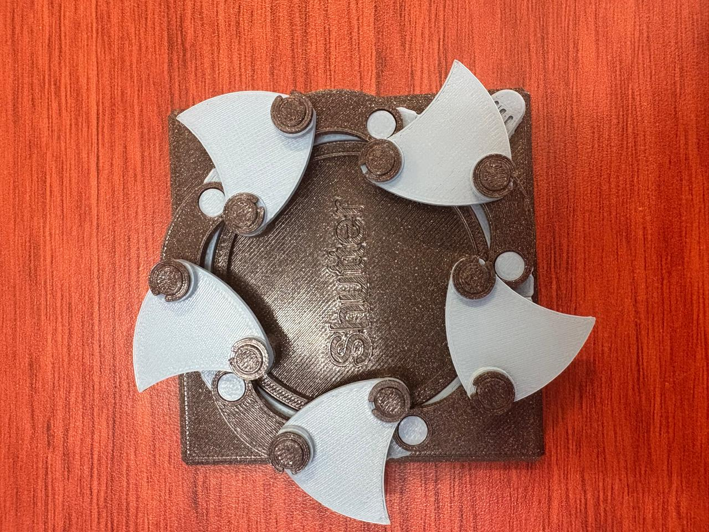
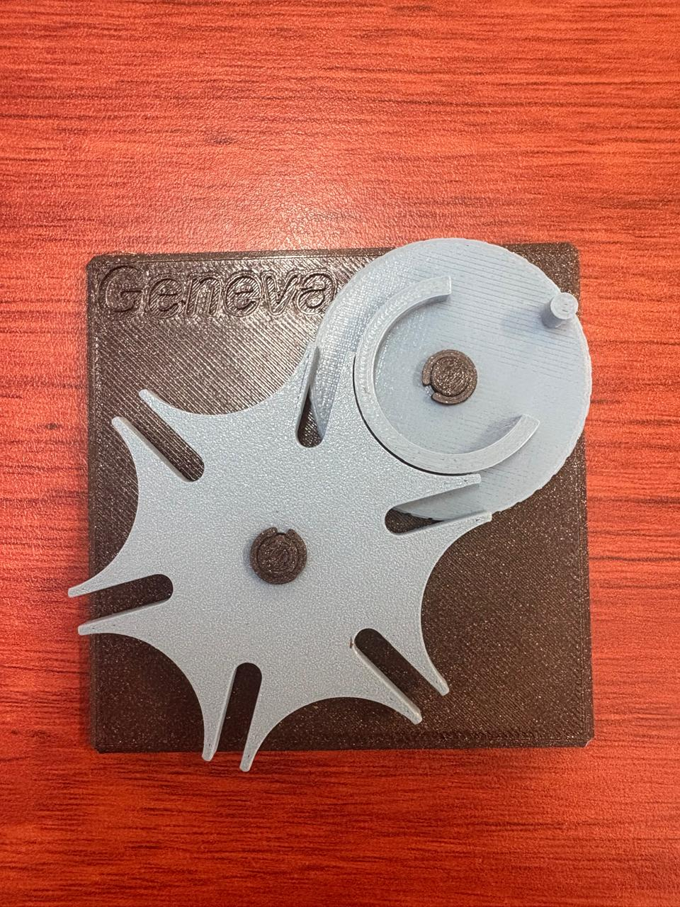
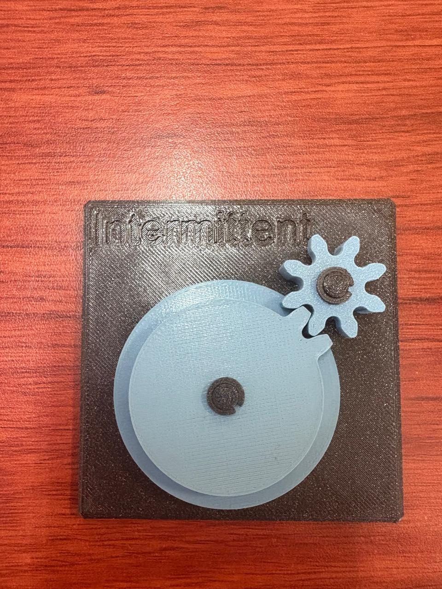
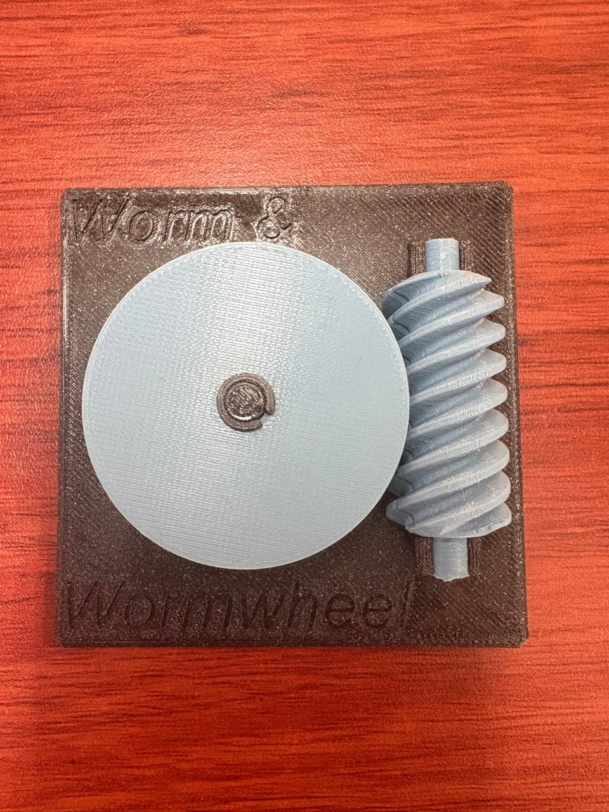
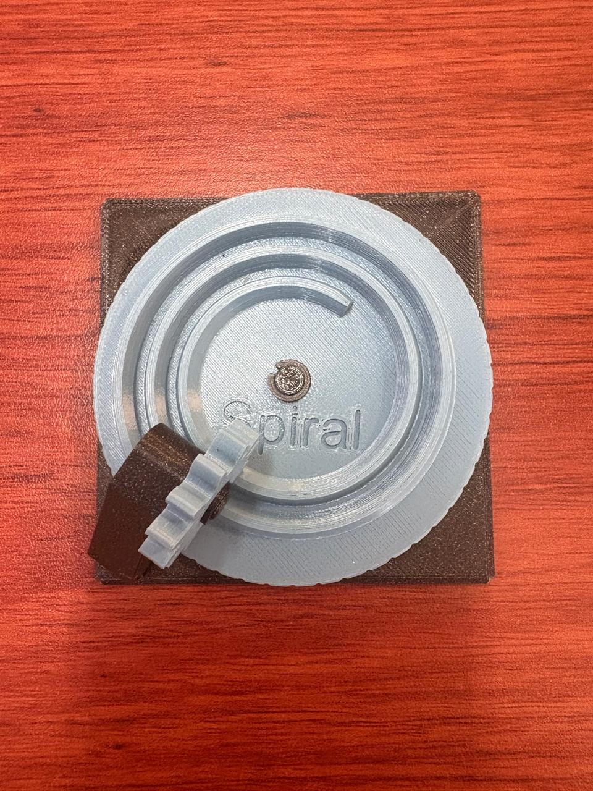
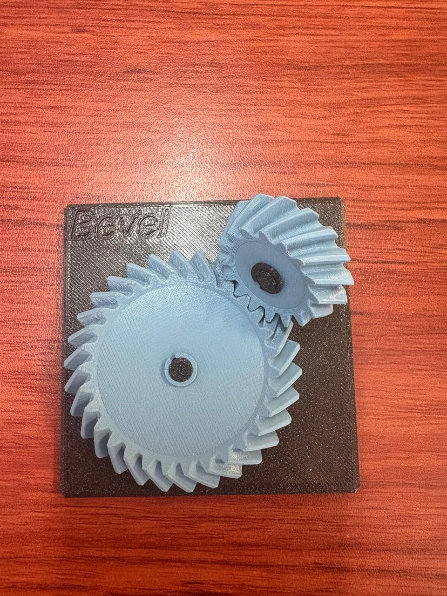

# Sesión 5 — Título c

## Qué debía lograr hoy
- Entender cómo los mecanismos transforman el movimiento 
-  calcular relaciones de transmisión simples
## Qué usé
- Planetary en 3D
- Bevel en 3D
- Spiral en 3D---
titulo: "Sesión 5 — Mecanismos y relaciones de transmisión"
fecha: 2026-09-18
autor: "Osorio Mario"
equipo: "Osorio Mario y Muñoz Maria"
estado: borrador   # borrador | completa
---

# Sesión 5 — Mecanismos y relaciones de transmisión

## 1. Objetivos

- Entender cómo los mecanismos transforman el movimiento.
- Calcular relaciones de transmisión simples.

## 2. Material usado

Modelos 3D de: planetary, bevel, spiral, cycloidal drive, worm drive, pulley, intermittent, geneva, universal joint, shutter y differential.

*Un motor rápido y débil se convierte en una salida lenta y fuerte mediante engranes o bandas.*

## 3. Teoría: relación de transmisión

La relación de transmisión $i$ compara un engrane de entrada (motriz, $Z_1$) con uno de salida (conducido, $Z_2$):

$$
i = \frac{Z_2}{Z_1} = \frac{\omega_{\text{entrada}}}{\omega_{\text{salida}}} = \frac{\tau_{\text{salida}}}{\tau_{\text{entrada}}}
$$

| Caso | Tipo | Efecto en la salida |
|------|------|---------------------|
| $i > 1$ | Reductor | Gira más lento, con más par (fuerza) |
| $i < 1$ | Multiplicador | Gira más rápido, con menos par |

- **Trenes compuestos:** las relaciones de cada etapa en serie se multiplican. Por ejemplo, $4 \times 16 = 64$.
- **Ejemplo:** piñón de 12 dientes y engrane de 36 dientes → $i = 36/12 = 3$. La salida gira a 1/3 de la velocidad con 3 veces el par.

> Los engranes no crean energía, solo la convierten: cambian velocidad por fuerza o al revés, según los dientes de cada uno (sin contar pérdidas por fricción).

## 4. Ejercicio: relación de transmisión

### Datos

| Caso | Motriz | Conducido | Dato conocido |
|------|--------|-----------|---------------|
| A | $Z_1 = 5$ | $Z_2 = 10$ | $\omega_2 = 10\ \text{rpm}$, $\tau_1 = 1\ \text{N·cm}$ |
| B | $Z_3 = 5$ | $Z_4 = 20$ | $\omega_3 = 20\ \text{rpm}$, $\tau_3 = 4\ \text{N·cm}$ |

**Incógnitas:** $\omega_1$ y $\tau_2$ (caso A); $\omega_4$ y $\tau_4$ (caso B).

### Caso A

$$
i_A = \frac{Z_2}{Z_1} = \frac{10}{5} = 2
$$

$$
\omega_1 = i_A \cdot \omega_2 = 2 \cdot 10 = 20\ \text{rpm}
\qquad
\tau_2 = i_A \cdot \tau_1 = 2 \cdot 1 = 2\ \text{N·cm}
$$

### Caso B

$$
i_B = \frac{Z_4}{Z_3} = \frac{20}{5} = 4
$$

$$
\omega_4 = \frac{\omega_3}{i_B} = \frac{20}{4} = 5\ \text{rpm}
\qquad
\tau_4 = i_B \cdot \tau_3 = 4 \cdot 4 = 16\ \text{N·cm}
$$

### Resultados

| Caso | $i$ | Velocidad | Par |
|------|-----|-----------|-----|
| A | 2 | $\omega_1 = 20\ \text{rpm}$ (entrada) → $\omega_2 = 10\ \text{rpm}$ | $\tau_2 = 2\ \text{N·cm}$ |
| B | 4 | $\omega_4 = 5\ \text{rpm}$ | $\tau_4 = 16\ \text{N·cm}$ |

**Conclusión:** en ambos casos $i > 1$, así que el sistema reduce la velocidad y multiplica el par por el mismo factor.

## 5. Tabla de estaciones

| Estación | ¿Qué transforma? | Relación $i$ | ¿Reversible o autobloqueante? | Vida real | Aplicación en el carro o proyecto |
|----------|------------------|--------------|-------------------------------|-----------|-----------------------------------|
| **A · Diferencial** | Reparte un giro de entrada en dos salidas con distinta velocidad y el mismo par | Corona-piñón ~3:1 a 4:1; satélites 1:1 | Reversible | *completar* | Permite que las ruedas giren distinto en curvas |
| **B · Reductor cicloidal** | Velocidad↔par: gran reducción en poco espacio y poco backlash | *cuenta vueltas de entrada por cada una de salida* | Casi autobloqueante (mucha fricción interna) | Modelo de práctica (engrane azul con lóbulos internos) | Articulaciones de robots; dirección asistida |
| **C · Junta cardán** | Cambio de eje: transmite giro entre ejes con ángulo; la salida acelera y desacelera dos veces por vuelta | 1:1 en promedio, con fluctuación | Reversible | Modelo de práctica (junta azul) | Flecha entre caja de velocidades y diferencial |
| **D · Obturador (shutter)** | Continuo→intermitente: una entrada mueve varias láminas sincronizadas | *depende del número de láminas* | No autobloqueante | Modelo de práctica (obturador negro con aspas azules) | Diafragma de cámara; iris para regular aire o luz |
| **E1 · Cónico espiral** | Cambio de eje a 90° con dientes en espiral (contacto más suave que el cónico recto) | *cuenta dientes de piñón y corona* | No autobloqueante | *completar* | Par cónico del diferencial trasero |
| **E2 · Junta cardán** | Igual que la estación C | 1:1 en promedio, con fluctuación | Reversible | *completar* | Normalmente en pares (doble cardán) para cancelar la irregularidad |

## 6. Evidencia

| | | |
|---|---|---|
|  |  |  |
| Engranajes completos | Diferencial | Shutter |
|  |  |  |
| Universal joint | Geneva | Intermittent |
|  |  |  |
| Worm | Spiral | Bevel |
- Cycloidal drive en 3D
- Worm/Worm drive en 3D
- Pulley en 3D
- Intermittent en 3D
- Geneva en 3D
- Universal joint en 3D
- Shutter en 3D
- Differential en 3D
## Qué hice y qué pasó (evidencia)
## Tabla de estaciones

*Diagrama donde se ilustra cómo un motor rápido y débil se convierte en salida lenta y fuerte mediante engranes o bandas.*

# Problema: Tren de engranes (relación de transmisión)

## 1. Datos

| Etapa | Engrane motriz | Engrane conducido | Dato conocido |
|-------|----------------|-------------------|---------------|
| 1 | $N_1 = 5$ dientes | $N_2 = 10$ dientes | $\omega_2 = 10\ \text{rpm}$, $T_1 = 1\ \text{N·cm}$ |
| 2 | $N_3 = 20$ dientes | $N_4 = 5$ dientes | $\omega_3 = 20\ \text{rpm}$, $T_3 = 4\ \text{N·cm}$ |

## 2. Incógnitas

- Etapa 1: $\omega_1$ y $T_2$
- Etapa 2: $\omega_4$ y $T_4$

## 3. Fórmulas

Relación de transmisión:

$$
i = \frac{N_{\text{motriz}}}{N_{\text{conducido}}} = \frac{\omega_{\text{salida}}}{\omega_{\text{entrada}}} = \frac{T_{\text{entrada}}}{T_{\text{salida}}}
$$

- $i < 1$ → **reductor**: gira más lento, entrega más fuerza (torque).
- $i > 1$ → **multiplicador**: gira más rápido, entrega menos fuerza.

## 4. Solución

### Etapa 1 (engranes 1 y 2)

**Relación de transmisión**

$$
i_1 = \frac{N_1}{N_2} = \frac{5}{10} = \frac{1}{2}
$$

**Velocidad de entrada**

$$
\frac{\omega_2}{\omega_1} = i_1 \;\Rightarrow\; \frac{10\ \text{rpm}}{\omega_1} = \frac{1}{2} \;\Rightarrow\; \omega_1 = 20\ \text{rpm}
$$

**Torque de salida**

$$
\frac{T_1}{T_2} = i_1 \;\Rightarrow\; \frac{1\ \text{N·cm}}{T_2} = \frac{1}{2} \;\Rightarrow\; T_2 = 2\ \text{N·cm}
$$

### Etapa 2 (engranes 3 y 4)

**Relación de transmisión**

$$
i_2 = \frac{N_3}{N_4} = \frac{20}{5} = 4
$$

**Velocidad de salida**

$$
\frac{\omega_3}{\omega_4} = i_2 \;\Rightarrow\; 4 = \frac{20\ \text{rpm}}{\omega_4} \;\Rightarrow\; \omega_4 = \frac{20\ \text{rpm}}{4} = 5\ \text{rpm}
$$

**Torque de salida**

$$
\frac{T_4}{T_3} = i_2 \;\Rightarrow\; 4 = \frac{T_4}{4\ \text{N·cm}} \;\Rightarrow\; T_4 = 16\ \text{N·cm}
$$

## 5. Resultados

| Etapa | Relación $i$ | Velocidad de salida | Torque de salida |
|-------|--------------|---------------------|------------------|
| 1 | $1/2$ | $\omega_2 = 10\ \text{rpm}$ (entrada $\omega_1 = 20\ \text{rpm}$) | $T_2 = 2\ \text{N·cm}$ |
| 2 | $4$ | $\omega_4 = 5\ \text{rpm}$ | $T_4 = 16\ \text{N·cm}$ |

## 6. Conclusión

Un engrane que gira más lento entrega más fuerza: al reducir la velocidad por un factor $i$, el torque se multiplica por ese mismo factor (sin considerar pérdidas por fricción).

## Relación de transmisión

La relación de transmisión (i) compara los dientes de dos engranes acoplados: uno de entrada (Z₁) y uno de salida (Z₂). La fórmula es:

**i = Z₂/Z₁ = ω_entrada/ω_salida = τ_salida/τ_entrada**

**Explicación:**
- Si **i > 1** (el engrane de salida tiene más dientes que el de entrada), el sistema **reduce**: la salida gira más lento pero con más fuerza (par).
- Si **i < 1** (el engrane de salida tiene menos dientes), el sistema **multiplica**: la salida gira más rápido pero con menos fuerza.
- Velocidad y par están en relación inversa: si divides la velocidad entre *i*, obtienes la velocidad de salida; si multiplicas el par de entrada por *i*, obtienes el par de salida (restando pequeñas pérdidas por fricción).

**Trenes compuestos:** cuando se conectan varias etapas de engranes en serie, sus relaciones individuales se multiplican entre sí. Por ejemplo, dos etapas con relación 1:4 y 1:16 combinadas dan una relación total de 1:64 — así es como una caja reductora pequeña (como la de un motor TT) logra una reducción grande (1:48) en poco espacio.

**Ejemplo:** un piñón de 12 dientes mueve un engrane de 36 dientes → i = 36/12 = 3. Esto significa que la salida gira a 1/3 de la velocidad de entrada, pero con 3 veces más par (fuerza).

los engranes no crean energía, solo la "convierten" — cambian velocidad por fuerza o viceversa, dependiendo de cuántos dientes tenga cada uno.
## Tabla de estaciones

| Estación | ¿Qué transforma? (vel↔par, rot↔trasl, continuo↔intermitente, cambio de eje) | Relación *i* estimada (cuenta dientes o vueltas) | ¿Reversible o autobloqueante? | ¿Dónde lo has visto en la vida real? | ¿Dónde serviría en el carro o en un proyecto tuyo? |
| --- | --- | --- | --- | --- | --- |
| **A · Diferencial** | Reparte un giro de entrada en dos salidas que pueden girar a distinta velocidad, manteniendo el mismo par | Corona-piñón típica ~3:1 a 4:1; satélites internos 1:1 | Reversible (no autobloqueante) | *completar aquí* | Eje trasero/delantero: permite que las ruedas internas y externas giren a distinta velocidad en curvas |
| **B · Reductor cicloidal** | vel↔par: reducción enorme en muy poco espacio, con poco backlash | *(cuenta vueltas de entrada por cada vuelta de salida)* | Cercano a autobloqueante por su alta fricción interna | Modelo de práctica (engrane azul con lóbulos internos) | Articulaciones de robots industriales; actuadores de dirección asistida |
| **C · Junta cardán (universal joint)** | Cambio de eje: transmite rotación entre ejes que forman un ángulo; la salida no es pareja (acelera/desacelera dos veces por vuelta) | 1:1 en promedio, con fluctuación cíclica | Reversible | Modelo de práctica (junta azul tipo universal joint) | Flecha de transmisión entre la caja de velocidades y el diferencial |
| **D · Obturador de láminas (leaf shutter)** | Continuo→intermitente: una sola entrada mueve varias láminas sincronizadas por un anillo | *(depende del número de láminas)* | No autobloqueante, el anillo gira libre en ambos sentidos | Modelo de práctica (obturador negro con aspas azules) | Diafragma de cámara; iris mecánico para regular flujo de aire o luz |
| **E1 · Engrane cónico espiral** | Cambio de eje: transmite rotación entre dos ejes perpendiculares (90°) mediante dientes en espiral, con contacto gradual y más suave que un cónico recto | *(cuenta dientes del piñón y la corona)* | No autobloqueante | *completar aquí* | Par cónico del diferencial trasero (conecta la flecha cardán con la corona) |
| **E2 · Junta cardán** | Cambio de eje: igual que la estación C, transmite rotación entre ejes angulados con velocidad de salida no uniforme | 1:1 en promedio, con fluctuación cíclica | Reversible | *completar aquí* | Flecha de transmisión, normalmente en pares (doble cardán) para cancelar la irregularidad |

