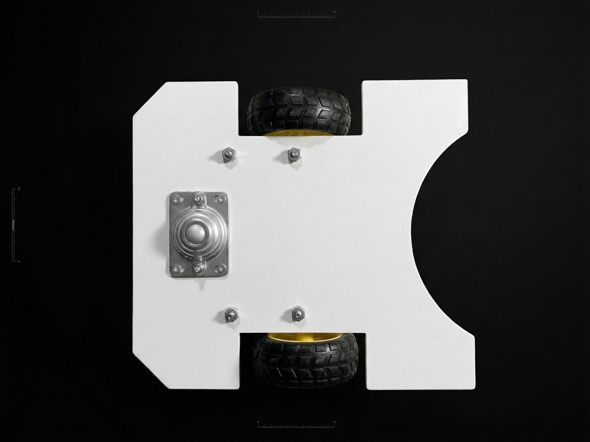
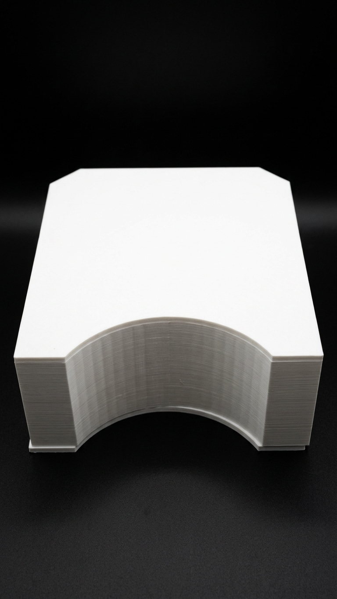
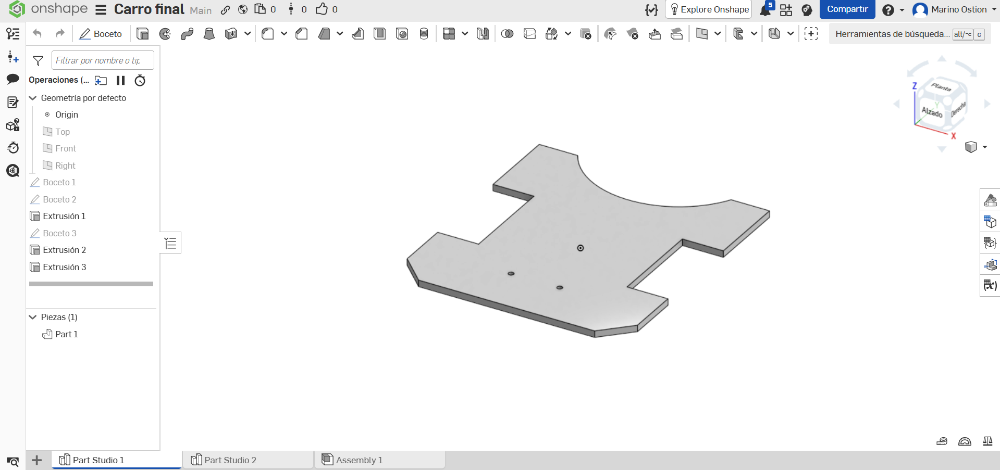
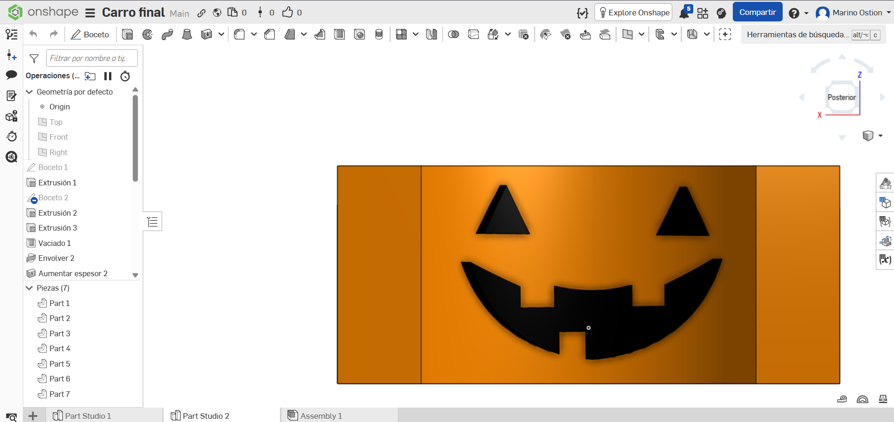
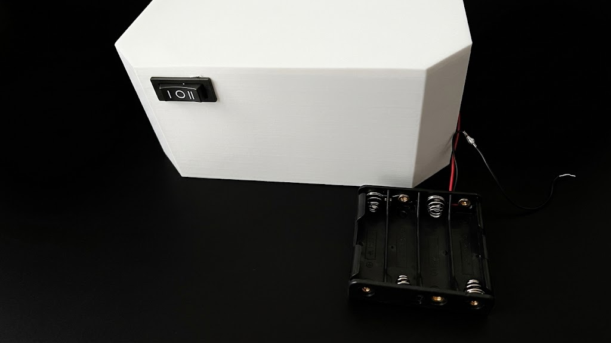
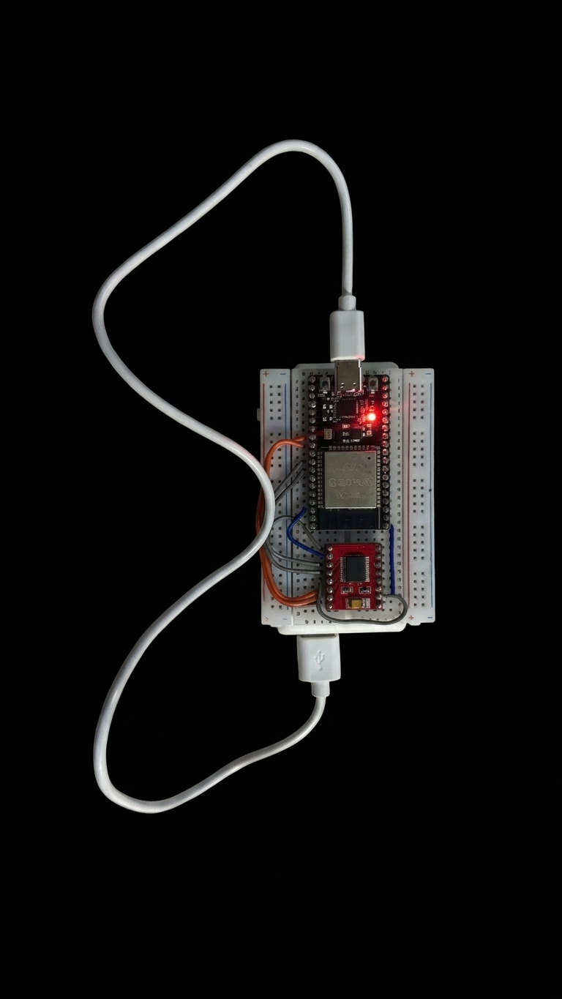
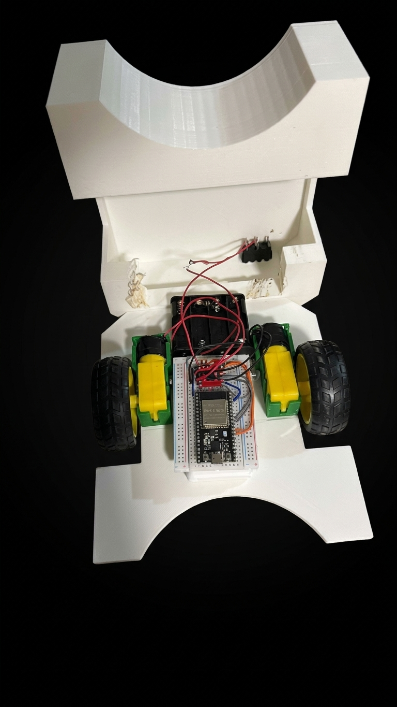

# Proyecto Parte 1 — Chasis del carrito

## Qué debía lograr hoy

- [✅] Diseñar e imprimir en 3D la base del carrito, con un lugar fijo para el interruptor
- [✅] Imprimir soportes para los motorreductores
- [✅] Montar motores, llantas, rueda de apoyo, portapilas con interruptor, power bank, protoboard y ESP32

## Qué usé

- Impresora 3D y filamento PLA (blanco para la base, verde para los soportes)
- Software de diseño 3D (Onshape)
- Software laminador (BambuLab)
- 2 motorreductores amarillos tipo TT
- 2 llantas de goma
- 1 rueda loca de apoyo (rueda circular móvil)
- Portapilas 4AA con interruptor de 3 posiciones
- Power bank de 5 V y cable USB
- ESP32 en protoboard
- Módulo controlador de motores (puente H)
- Cables jumper
- Tornillos y tuercas
- Cinta doble cara y cinta aislante

## Qué hice y qué pasó (evidencia)

### 1. Configuración de ruedas

Lo primero fue decidir cuántas ruedas necesitaba el carrito. Elegimos una configuración de dos ruedas motrices y una rueda loca de apoyo, similar a la de un robot aspiradora tipo Roomba. Con ella el carrito puede girar sobre su propio eje, lo que facilita las maniobras.

La rueda de apoyo se colocó en la parte trasera para equilibrar el carrito y repartir mejor el peso. Los motorreductores van sujetos a la base con tornillos y tuercas.

Figura 1. Vista inferior del chasis: llantas, rueda de apoyo y tornillería de los motores.

### 2. Diseño e impresión 3D del chasis

Para el chasis trabajamos en Onshape, dentro del documento "Carro final", y lo dividimos en tres piezas: los soportes de los motores, la base y la carcasa. Después laminamos las piezas en BambuLab y las imprimimos en PLA: blanco para la base y verde para los soportes de los motores.

Figura 2. Pieza del chasis impresa en PLA blanco.

Para sujetar los motorreductores TT descargamos un modelo 3D ya hecho, que importamos a Onshape y adaptamos a nuestras medidas. Así no tuvimos que diseñar desde cero la geometría de los soportes, que necesita ajustes precisos.

.png)
Figura 2.1. Modelo 3D del soporte para motorreductores TT, descargado e importado a Onshape para asegurar los motores al chasis.

La base la diseñamos nosotros. Es una placa plana con esquinas achaflanadas y recortes laterales para alojar las llantas. Tiene perforaciones para fijar los soportes de los motores y la rueda de apoyo con tornillos y tuercas.

Figura 2.2. Modelo 3D de la base del chasis, diseñada en Onshape.

Por último, diseñamos la carcasa que cubre y protege la electrónica. Incluye el compartimento del portapilas y el lugar fijo del interruptor en la parte trasera.

Figura 2.3. Modelo 3D de la carcasa del carrito, diseñada en Onshape.

### 3. Alimentación de los motores

Para los motores usamos un portapilas 4AA, que entrega más corriente que una sola pila y ayuda a que el carrito se mueva con más rapidez y fuerza.

El encendido y apagado se hace con un interruptor de tres posiciones. Está montado en un lugar fijo en la parte trasera del chasis, diseñado e impreso en 3D, por lo que queda firme y accesible.

Figura 3. Interruptor montado en la pared impresa y portapilas 4AA con sus cables.

### 4. Alimentación y conexiones del control

El ESP32 se alimenta con una power bank de 5 V mediante un cable USB, independiente de los motores. Así los arranques de los motores no afectan al microcontrolador. El ESP32 está montado en una protoboard junto con el módulo controlador de motores, y se conectan con cables jumper.

El LED rojo encendido en la fotografía confirma que la placa recibe alimentación. Las soldaduras de los motores se cubrieron con cinta aislante para que no se rompieran.

Figura 4. ESP32 y módulo controlador de motores en la protoboard, alimentados por USB.

### 5. Integración y distribución de componentes

Finalmente integramos todo en el chasis. Los motorreductores quedan en sus soportes verdes a ambos lados, con las llantas hacia afuera. La protoboard con el ESP32 se fijó con cinta doble cara al frente de la base, y el portapilas va detrás. La parte trasera elevada del chasis aloja el portapilas y el interruptor, de modo que el peso queda atrás y cerca de la rueda de apoyo.

Figura 5. Chasis ensamblado: motores, llantas, portapilas, protoboard y ESP32.

## Tabla 1. Componentes del carrito y su función

| Pieza | Material | Cantidad | Función |
| ----- | -------- | -------- | ------- |
| Base | PLA blanco | 1 | Soporta los motores, la rueda de apoyo y la electrónica |
| Carcasa | PLA blanco | 1 | Cubre la electrónica, aloja el portapilas y fija el interruptor |
| Soporte de motor | PLA verde | 2 | Fija cada motorreductor a la base |
| Motorreductor TT | — | 2 | Tracción |
| Llanta 65 mm | Goma / plástico | 2 | Contacto con el piso |
| Rueda loca de apoyo | Metal | 1 | Apoyo trasero y giro sobre su eje |
| Portapilas 4AA con interruptor | — | 1 | Alimenta los motores |
| Power bank 5 V | — | 1 | Alimenta el ESP32 |
| ESP32 con protoboard | — | 1 | Control del carrito |
| Módulo controlador de motores | — | 1 | Maneja los motores desde el ESP32 |

## Qué falló y cómo lo resolví

- Síntoma: Las llantas giraban en sentidos contrarios, así que el carrito no avanzaba derecho.
- Cómo lo encontré: Al probar los motores, una llanta giraba hacia adelante y la otra hacia atrás.
- Solución: Invertí la conexión de uno de los motores para que ambas llantas giraran en el mismo sentido.

- Síntoma: El chasis no encajaba y los componentes se movían de su lugar.
- Cómo lo encontré: Al ensamblar, las piezas impresas no coincidían con las medidas del diseño, y al mover el carrito los componentes se corrían.
- Solución: Ajusté las tolerancias en el diseño, volví a imprimir las piezas para que encajaran bien y fijé los componentes con cinta doble cara.

## Qué aprendí

Aprendí que al diseñar para impresión 3D hay que dejar tolerancias, porque la pieza impresa no sale exactamente de la medida del diseño. Por eso el chasis no encajaba al principio y tuvimos que ajustar el modelo y volver a imprimir. También entendí que es mejor pensar desde el diseño dónde va cada componente y dejar impresos los lugares fijos, como el del interruptor. Así los componentes no se mueven de su lugar y no dependemos solo de cinta doble cara.

Aprendí que la posición del peso (portapilas, power bank, ESP32) cambia el equilibrio y la tracción del carrito, y que la rueda loca de apoyo trasera es la que mantiene la estabilidad con solo dos llantas motrices.

También aprendí que dos motores montados en espejo giran en sentidos contrarios con la misma polaridad. Para que las dos llantas avancen en el mismo sentido hay que invertir la conexión de uno de ellos, o cambiar el sentido en el código.

Por último, usar un modelo 3D ya hecho para los soportes de los motores TT nos ahorró tiempo, pero hay que adaptarlo a las medidas reales de nuestras piezas. Separar la alimentación de los motores (portapilas 4AA) de la del ESP32 (power bank) evita que los arranques de los motores afecten al microcontrolador.
## Siguiente paso

Esperar el día de la competición y ganar 